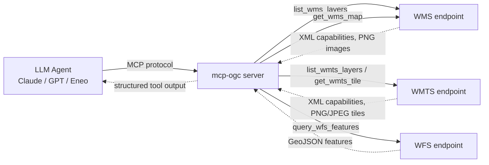

# mcp-ogc

[](https://github.com/nickoulos/mcp-ogc/actions/workflows/ci.yml)
[](LICENSE)
[](https://www.python.org/)

Expose OGC **WMS**, **WMTS** and **WFS** geospatial services as [Model Context Protocol](https://modelcontextprotocol.io)
tools, so LLM agents can discover layers, render maps, and query vector features from any
standards-compliant geodata server.

## What it does

`mcp-ogc` runs as an MCP server that any MCP-compatible client (Claude Desktop, custom agents,
Eneo assistants) can attach to. It exposes five tools:

- **`list_wms_layers(wms_url)`** — discover what layers a WMS endpoint exposes (name, title,
  abstract, supported CRS, bounding box).
- **`get_wms_map(wms_url, layer, bbox, ...)`** — fetch a rendered map image for a bounding box.
- **`list_wmts_layers(wmts_url)`** — discover the layers of a tiled (WMTS) map service, with their
  formats, styles and tile matrix sets (CRS + zoom levels).
- **`get_wmts_tile(wmts_url, layer, tile_matrix_set, tile_matrix, ...)`** — fetch one tile, located
  by `row` + `column` or by a `point` in the tile grid's CRS (the tool finds the tile containing it).
- **`query_wfs_features(wfs_url, type_name, bbox, ...)`** — query vector features as GeoJSON.

This means an agent can ask *"what layers does this municipal map server have, and what's at this
location?"* against any INSPIRE-compliant GIS service — without per-service custom integration.

## Why

Municipal and national GIS data is overwhelmingly published via OGC standards (WMS, WFS). LLM
agents speak REST and JSON. `mcp-ogc` bridges them in a few hundred lines of Python so geospatial
reasoning becomes available to any LLM workflow.

Built by [Foursight Lab](https://foursightlab.com).

## Architecture



## Quick start

Requires Python 3.12+ and [uv](https://docs.astral.sh/uv/).

```bash
git clone https://github.com/nickoulos/mcp-ogc
cd mcp-ogc
uv sync
uv run mcp-ogc
```

To attach to Claude Desktop, add this to your `claude_desktop_config.json`
(see [`examples/claude_desktop.json`](examples/claude_desktop.json)):

```json
{
  "mcpServers": {
    "ogc": {
      "command": "mcp-ogc"
    }
  }
}
```

See [`examples/demo.ipynb`](examples/demo.ipynb) for a full walkthrough of the three tools against
a live public WMS/WFS.

### Streamable HTTP

`mcp-ogc` defaults to stdio, but MCP clients that require Streamable HTTP (e.g. Eneo) can run it
as an HTTP server instead:

```bash
uv run mcp-ogc --transport streamable-http --host 0.0.0.0 --port 8000
```

DNS-rebinding protection is enabled on the HTTP transport, with an allowlist covering
`127.0.0.1`, `localhost`, `[::1]`, and `host.docker.internal` (for clients running in Docker).

### Protected endpoints

Credentials are configured per host in the `MCP_OGC_AUTH` environment variable, never passed as
tool arguments, so the LLM never sees them. HTTP Basic (`username` + `password`) and Bearer tokens
(`token`) are supported:

```json
{
  "mcpServers": {
    "ogc": {
      "command": "mcp-ogc",
      "env": {
        "MCP_OGC_AUTH": "{\"karta.example.se\": {\"username\": \"alice\", \"password\": \"...\"}, \"tiles.example.se\": {\"token\": \"...\"}}"
      }
    }
  }
}
```

- Each entry is sent **only** to its own host (keys may include a port, e.g. `host:8443`), so an
  agent cannot leak credentials by pointing a tool at another URL.
- Credentials are only sent over **https**; add `"allow_insecure_http": true` to an entry to
  override that for a trusted internal endpoint.
- Credentials are never logged, persisted, or echoed in error messages.

### Caching and retries

Both are opt-in, via environment variables, so the default stays simple (no cache, no retries):

| Variable | Default | Effect |
| --- | --- | --- |
| `MCP_OGC_CACHE_TTL` | `0` (off) | Seconds to keep parsed GetCapabilities documents in memory, so repeated tool calls on one endpoint don't refetch them. |
| `MCP_OGC_RETRIES` | `0` | Retries for transient failures: connection errors, timeouts, HTTP 5xx. Client errors (4xx) are never retried. |
| `MCP_OGC_RETRY_BACKOFF` | `0.5` | Base delay in seconds; retry *n* waits `base * 2**n` (0.5 s, 1 s, 2 s, ...). |

The cache holds at most 64 endpoints (least recently used evicted) and is keyed by endpoint and
auth configuration, so different credentials never share an entry.

## Development

```bash
uv sync            # install deps (incl. dev tools)
uv run pytest -q   # run the hermetic test suite (no network)
uv run ruff check  # lint
```

## License

[AGPL-3.0-or-later](LICENSE).

## Roadmap

- **v0.2:** WFS attribute filtering (CQL), WMTS support, basic/OAuth auth for protected endpoints
- **v0.3:** caching layer, retry/backoff
- **v1.0:** broader OGC API client surface
